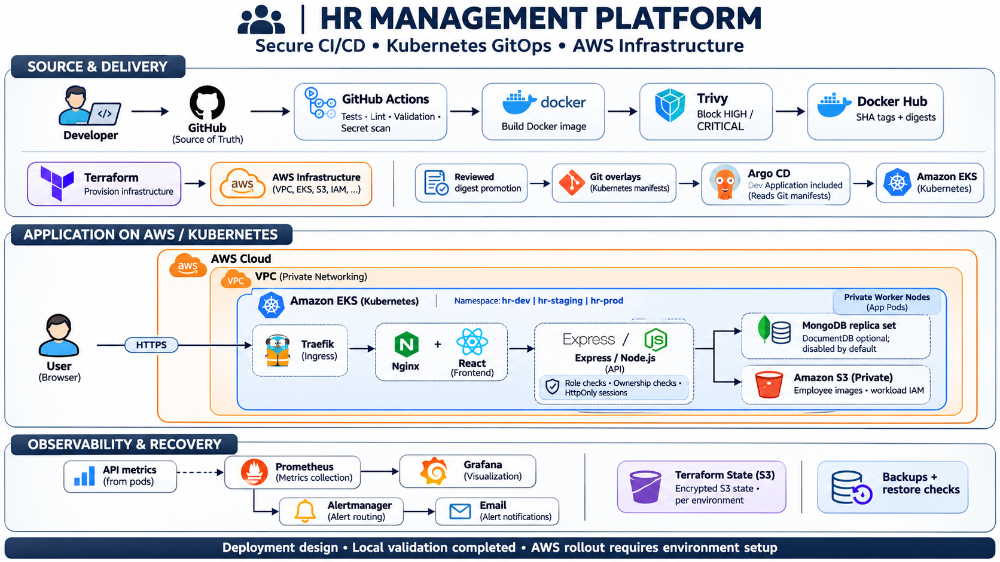
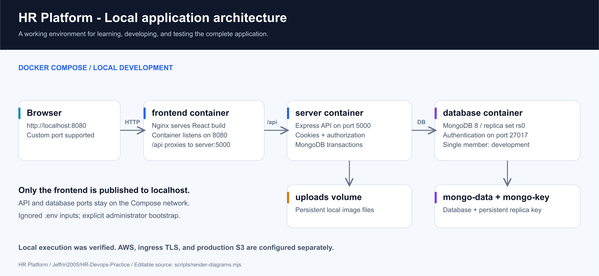
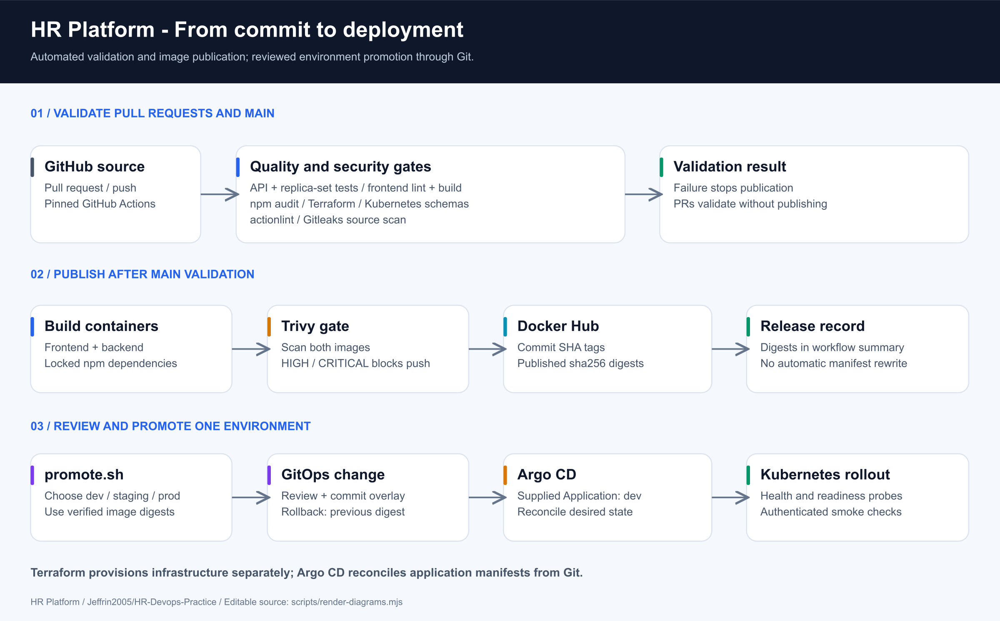

# HR Management Platform

**An HR application with a DevOps delivery workflow: containers, Kubernetes GitOps, security checks, and AWS infrastructure as code.**

React and Express provide administrator and employee workflows, backed by MongoDB. This repository brings the application and its delivery configuration together: Docker, Kubernetes overlays, GitHub Actions, Argo CD, Terraform, Prometheus, Grafana, and recovery scripts.

[Quick start](#quick-start) · [Architecture](docs/ARCHITECTURE.md) · [Operations](docs/OPERATIONS.md) · [CI/CD](docs/CI-CD.md) · [Interview guide](docs/INTERVIEW.md)



*Configured deployment design. The latest repairs were verified locally; applying and validating them in AWS is a separate step.*

## Application features

| Area | Administrator | Employee |
| --- | --- | --- |
| Employees | Create/update records and view directory | View own profile |
| Departments | Create, update, archive | View department in profile |
| Salary | Add records and view salary history | View own salary history |
| Leave | View and decide pending requests | Submit and view own leave |
| Attendance | Mark attendance and view reports | Administrator-only management |
| Account | Explicit first-administrator bootstrap | Change own password and sign out |

The API enforces roles and record ownership. Salary arithmetic preserves decimals. Department archiving retains employee and payroll history.

## Technology and responsibilities

| Layer | Implementation |
| --- | --- |
| Browser UI | React 19, Vite, Tailwind CSS, Axios |
| Web serving | Unprivileged Nginx serves the React build and proxies /api |
| API | Node.js 24, Express 5, Mongoose, Zod |
| Sessions | Signed JWT in an HttpOnly SameSite cookie; revocation on logout/password change |
| Database | Authenticated development MongoDB replica set; external managed database for staging/production |
| Uploads | Persistent development storage; private S3 in production |
| Delivery | GitHub Actions, Gitleaks, Trivy, Docker Hub, Kustomize, Argo CD |
| AWS | Terraform: VPC, IAM, EKS, S3, optional DocumentDB |
| Observability | Prometheus, Grafana, Alertmanager, internal health/metrics |

This is a three-tier application with one Express backend. Modules inside the API are not independently deployed microservices.

## Quick start

Requirements: Docker with Compose. Node.js 24 is needed for source development and local test commands.

```sh
git clone https://github.com/Jeffrin2005/HR-Devops-Practice.git
cd HR-Devops-Practice
```

Copy [.env.example](.env.example) to an ignored `.env` file without overwriting existing settings. Supply MONGO_USERNAME and independent random hexadecimal MONGO_PASSWORD/JWT_KEY values. Generate each secret with:

```sh
node -e "console.log(require('crypto').randomBytes(32).toString('hex'))"
docker compose up --build -d --wait
```

Create your first administrator with the [Windows/Bash bootstrap instructions](docs/LOCAL-DEVELOPMENT.md#first-administrator), then open [localhost:8080](http://localhost:8080). There are no automatic demo credentials. Set FRONTEND_PORT to another free port if needed.



Only the frontend is published to localhost. MongoDB and the API remain on the Compose network. Named volumes persist the database, replica key, and local images. The development database has a single replica-set member.

## Delivery workflow



1. PRs and main changes run tests, lint/build, dependency/secret scans, and infrastructure/workflow validation.
2. Successful main validation allows frontend/backend image builds.
3. Trivy checks the images; high or critical findings block publication.
4. Docker Hub receives commit-SHA tags; the workflow records published digests.
5. `scripts/promote.sh` updates the selected environment using verified digests.
6. Review and commit the overlay change; Argo CD reconciles the configured environment.

The supplied Argo CD Application targets **dev**. Staging and production need their own reviewed Applications and environment configuration. See [CI/CD](docs/CI-CD.md).

## Repository map

```text
app/frontend/       React UI, Nginx, frontend image
app/server/         API, validation, models, uploads, tests, migration
k8s/base/           Shared resources and development database manifests
k8s/overlays/       dev, staging, prod namespaces and patches
k8s/ingress/        Traefik Helm values
k8s/argocd/         Development GitOps Application
k8s/monitoring/     Helm values, ServiceMonitor, alert rules, dashboard
k8s/chaos/          Optional Litmus manifest; separate installation required
terraform/         AWS modules, environments, state, S3 workload IAM
.github/           CI workflow and Dependabot
scripts/           Validate, deploy, promote, backup, restore, diagrams
docs/              Architecture, setup, operations, interview notes
architecture.png   Main diagram generated from editable source
```

## Local validation

Verified on **18 November 2026** against the repaired working copy:

| Check | Result |
| --- | --- |
| API regression and real replica-set integration tests | 22 passed |
| Frontend lint and production build | Passed |
| Docker builds, startup, authenticated smoke checks | Passed |
| Built frontend/backend image scans | Zero high/critical findings and zero detected secrets |
| Production npm audits | Zero reported advisories |
| Terraform, Kubernetes schemas, workflow, Helm rendering | Passed |
| Current source secret scan | Passed |
| Synthetic MongoDB backup and isolated restore | Passed |

These are dated local results, not a claim about a current GitHub run or live AWS deployment. Frontend build tooling still includes an [upstream picomatch advisory without a published fix](https://github.com/advisories/GHSA-fc5q-39xc-vjpf). Keep build inputs trusted and the development server private.

## Documentation

- [Local setup and administrator bootstrap](docs/LOCAL-DEVELOPMENT.md)
- [Architecture and request flow](docs/ARCHITECTURE.md)
- [CI/CD, promotion, rollback](docs/CI-CD.md)
- [Kubernetes, monitoring, migration, recovery](docs/OPERATIONS.md)
- [AWS Terraform and state](terraform/README.md)
- [API access rules](app/server/README.md)
- [Frontend development](app/frontend/README.md)
- [Interview explanation and questions](docs/INTERVIEW.md)
- [GitHub About description and topics](docs/REPOSITORY.md)

## Before an existing or production deployment

Revoke previously exposed database/SMTP credentials and replace deployed secrets. Back up existing data and run the migration deliberately. Supply real DNS, TLS, database credentials, workload IAM, and storage configuration. Promote verified image digests and test the rollout, alert delivery, and recovery.

The manifests retain RELEASE_REQUIRED and environment placeholders until configured. Deployment helpers reject unresolved values. Follow the [operations guide](docs/OPERATIONS.md).
