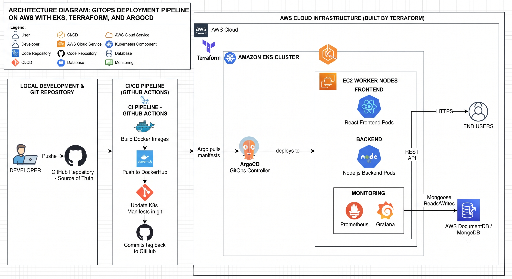

# 🚀 Enterprise HR Management Platform (Cloud-Native)

Welcome to the **HR Employee Management System** repository. This project demonstrates a production-grade **Enterprise DevOps Architecture** built from the ground up. It deploys a modern MERN stack application using GitOps principles, modular Infrastructure as Code (IaC), Kubernetes, and Cloud-Native observability and chaos engineering.

---

## 🏗️ Architecture Diagram



---

## 📂 Project Structure

```text
HR-Devops-Practice/
│
├── app/
│   ├── frontend/                       # Vite + React Frontend
│   │   ├── public/
│   │   ├── src/
│   │   ├── Dockerfile
│   │   ├── nginx.conf
│   │   ├── package.json
│   │   ├── package-lock.json
│   │   └── .dockerignore
│   │
│   └── server/                         # Node.js + Express API Backend
│       ├── controllers/
│       ├── db/
│       ├── middleware/
│       ├── models/
│       ├── public/
│       ├── routes/
│       ├── Dockerfile
│       ├── package.json
│       ├── package-lock.json
│       └── .dockerignore
│
├── terraform/                          # Modular AWS Infrastructure as Code
│   ├── main.tf
│   ├── provider.tf
│   ├── versions.tf
│   ├── variables.tf
│   ├── locals.tf
│   ├── data.tf
│   ├── outputs.tf
│   ├── environments/
│   │   ├── dev.tfvars
│   │   ├── staging.tfvars
│   │   └── prod.tfvars
│   ├── modules/
│   │   ├── vpc/
│   │   ├── iam/
│   │   ├── eks/
│   │   └── documentdb/
│   ├── .gitignore
│   └── README.md
│
├── k8s/                                # Kubernetes Manifests & GitOps
│   │
│   ├── base/                           # Base microservices manifests
│   │   ├── frontend/
│   │   │   ├── deployment.yaml
│   │   │   ├── service.yaml
│   │   │   └── hpa.yaml
│   │   ├── backend/
│   │   │   ├── deployment.yaml
│   │   │   └── service.yaml
│   │   ├── database/
│   │   │   ├── deployment.yaml
│   │   │   ├── service.yaml
│   │   │   └── pvc.yaml
│   │   ├── networking/
│   │   │   └── ingress.yaml
│   │   └── kustomization.yaml
│   │
│   ├── overlays/                       # Environment-specific overlays
│   │   ├── dev/
│   │   │   ├── kustomization.yaml
│   │   │   └── replica-patch.yaml
│   │   ├── staging/
│   │   │   ├── kustomization.yaml
│   │   │   └── replica-patch.yaml
│   │   └── prod/
│   │       ├── kustomization.yaml
│   │       └── replica-patch.yaml
│   │
│   ├── argocd/                         # GitOps Argo CD application definition
│   │   └── hr-application.yaml
│   │
│   ├── monitoring/                     # Prometheus, Grafana & Alertmanager
│   │   ├── prometheus/
│   │   │   ├── deployment.yaml
│   │   │   ├── service.yaml
│   │   │   └── prometheus-config.yaml
│   │   ├── grafana/
│   │   │   ├── deployment.yaml
│   │   │   ├── service.yaml
│   │   │   └── dashboard-configmap.yaml
│   │   └── alertmanager/
│   │       └── values.yaml
│   │
│   └── chaos/                          # Chaos Engineering with Litmus Chaos
│       └── pod-delete-experiment.yaml
│
├── .github/
│   └── workflows/
│       └── ci.yml                      # CI/CD GitHub Actions Pipeline
│
├── scripts/                            # Operational helper scripts
│   ├── deploy.sh
│   ├── destroy.sh
│   └── validate.sh
│
├── docker-compose.yml                  # Local full-stack container orchestration
├── architecture.png                    # Architectural reference diagram
├── .gitignore                          # Root ignore rules
└── README.md                           # Project documentation
```

---

## ⚙️ DevOps Components & Workflow

### 1. Developer Code (`app/`)
*   **Frontend**: React (Vite + Tailwind CSS), multi-stage Docker build served via NGINX.
*   **Server**: Node.js Express API connecting to DocumentDB / MongoDB with JWT authentication.

### 2. Infrastructure as Code (`terraform/`)
*   Fully modular structure provisioning **VPC**, **IAM roles**, **EKS cluster & managed node groups**, and **DocumentDB cluster**.
*   Multi-environment support via `environments/dev.tfvars`, `environments/staging.tfvars`, and `environments/prod.tfvars`.

### 3. Kubernetes & GitOps (`k8s/`)
*   **Base manifests** organized by microservice (`frontend/`, `backend/`, `database/`, `networking/`).
*   **Kustomize overlays** dynamically scale replica counts per environment (`dev`: 1 replica, `staging`: 2 replicas, `prod`: 3 replicas).
*   **Argo CD** tracks the repository and continuously syncs production state to the cluster.
*   **Monitoring** includes Prometheus scraping, Grafana dashboards, and Alertmanager notification routing.
*   **Chaos Engineering** verifies self-healing resilience with Litmus Chaos pod deletion experiments.

### 4. CI/CD Pipeline (`.github/workflows/ci.yml`)
1.  **Code Quality**: SonarCloud static analysis on every push.
2.  **Container Build**: Builds and pushes Docker images to DockerHub.
3.  **Security Scanning**: Trivy scans container images for CRITICAL/HIGH vulnerabilities.
4.  **GitOps Sync**: Updates image tags directly in `k8s/base/frontend/deployment.yaml` and `k8s/base/backend/deployment.yaml`.

---

## 🚀 Quick Start

### Run Locally with Docker Compose
```bash
docker compose up -d
```
Access Frontend: `http://localhost:8080`  
Access Backend: `http://localhost:5000`

### Provision AWS Cloud Infrastructure
```bash
cd terraform
terraform init
terraform plan -var-file="environments/dev.tfvars"
terraform apply -var-file="environments/dev.tfvars"
```

### Validate Kubernetes Manifests
```bash
./scripts/validate.sh
```

### Deploy to Kubernetes
```bash
# Deploy base or environment overlays
./scripts/deploy.sh dev
# or
./scripts/deploy.sh prod
```

---
*Built with ❤️ and modern DevOps best practices.*
