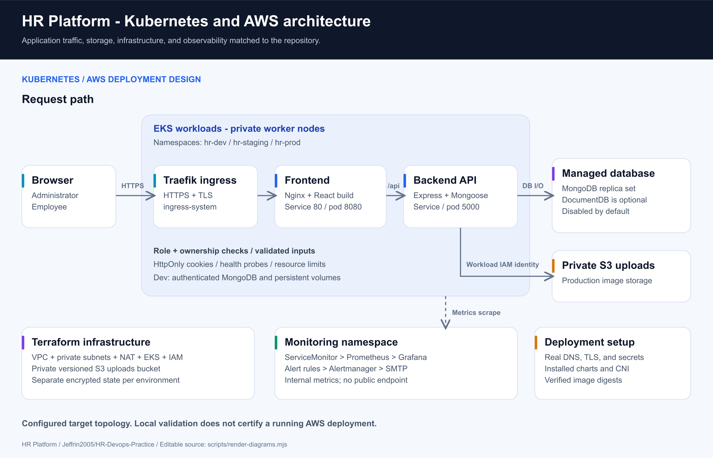

# Architecture

[Project README](../README.md)



## Request flow

Browser → Traefik HTTPS ingress → frontend Service → Nginx → backend Service → Express → database.

Nginx serves compiled React files and forwards /api requests to the API. The backend is one deployment organized into routes, middleware, controllers, and models. In Compose there is no Traefik hop.

## Sessions and permissions

Login validates the input and compares a bcrypt password hash. A successful response sets an HttpOnly SameSite cookie. Subsequent requests verify the JWT signature, expiry, issuer/audience, account state, and token version. Role checks protect administrator actions; ownership checks protect individual employee records. Logout and password changes invalidate existing sessions. Production cookies require HTTPS.

## Environment differences

| Concern | Compose | Kubernetes dev | Staging/production design |
| --- | --- | --- | --- |
| Entry | localhost Nginx | Traefik ingress | Traefik HTTPS + trusted TLS |
| Database | Authenticated single-member replica set | MongoDB + PVC | External managed replica set / optional DocumentDB |
| Uploads | Named volume | PVC | Private S3 |
| Inputs | Ignored root .env | Kubernetes secrets | Environment secrets + workload IAM |
| Isolation | Compose network | hr-dev | hr-staging / hr-prod |

Names remain stable inside each namespace. Metrics Server is required for the frontend HPA. The CNI must enforce NetworkPolicy. Development MongoDB is not highly available.

## Infrastructure versus application delivery

Terraform defines the VPC, private worker nodes, EKS, IAM, S3, and optional DocumentDB. State uses an encrypted S3 backend with separate keys per environment.

Argo CD reconciles application manifests in Git. The supplied Application covers dev. TLS, secrets, installed charts, a least-privilege database user, and verified release digests must be configured.

DocumentDB is disabled by default. When enabled, its module configures encryption, managed master credentials, backups, deletion protection, and environment-dependent instance counts.

## Storage and operations

Employee writes use transactions and require a replica-set-capable database. Unique indexes protect normalized email, employee references/IDs, and employee/pay-date salary records. Money is converted through decimal strings to minor units before arithmetic. Department archiving retains employee/payroll history.

Images are size/type limited, decoded with pixel limits, and re-encoded. Image reads require authorization. Production S3 access uses the backend workload IAM role.

Internal health endpoints support probes. ServiceMonitor configures Prometheus scraping; Grafana presents request/latency metrics; alert rules feed Alertmanager. Nginx blocks public health/metrics paths.

## Editable diagram sources

[Architecture SVG](assets/architecture.svg) · [Local SVG](assets/local-development.svg) · [Pipeline SVG](assets/release-pipeline.svg)

After installing server dependencies, regenerate all SVG/PNG assets with:

```sh
node scripts/render-diagrams.mjs
```

These are architecture diagrams, not screenshots or evidence of a running cloud deployment.
