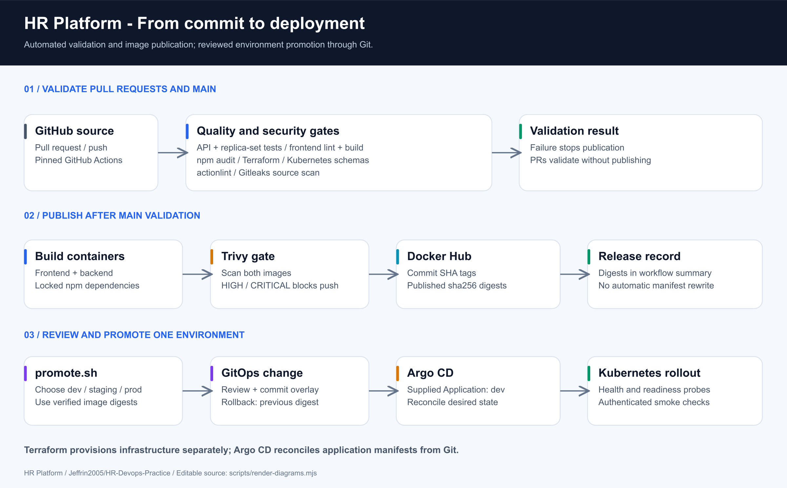

# CI/CD and GitOps

[Project README](../README.md)



## Validate

[ci.yml](../.github/workflows/ci.yml) runs for PRs, pushes to main, and manual dispatch. It checks production npm advisories, frontend lint/build, API regression tests, a disposable MongoDB replica-set integration suite, Terraform, Kubernetes schemas, workflow syntax, and source secrets.

The test database is isolated on the runner and removed afterwards.

## Publish

Publication requires successful main validation. Both images are built and scanned before pushing. Trivy high/critical findings stop publishing. Configure DOCKERHUB_USERNAME and DOCKERHUB_TOKEN in GitHub Secrets.

Images use source commit SHA tags. Published sha256 references appear in the workflow summary. Actions and base images are pinned; Dependabot is configured.

## Promote

```sh
./scripts/promote.sh dev sha256:FRONTEND_DIGEST sha256:BACKEND_DIGEST
```

Replace the examples with real 64-character digests. The script updates only the selected overlay, validates rendering, and shows the diff. Review and commit the change.

The supplied Argo CD Application watches dev on main with self-healing enabled and pruning disabled. Staging/production need their own reviewed Applications. Configure deployment prerequisites before synchronization.

## Roll back

Use previous verified digests with promote.sh and commit the change. Check readiness and authenticated behavior. An image rollback does not undo a database migration; handle migrations separately.

Terraform provisions infrastructure separately. CI does not rewrite shared base manifests or automatically promote every environment. Local validation does not prove that the updated workflow has run remotely.
